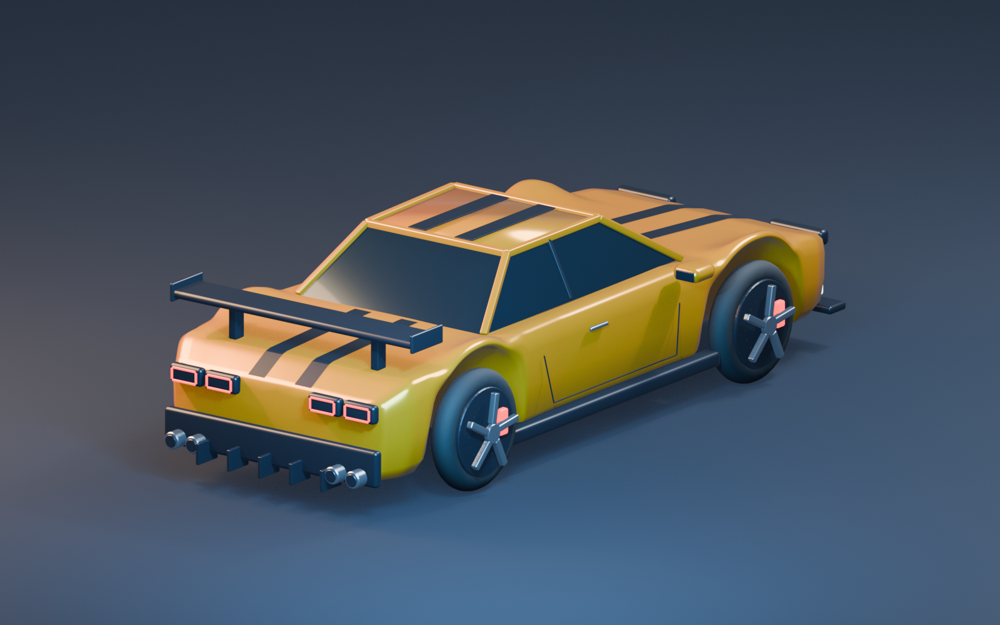
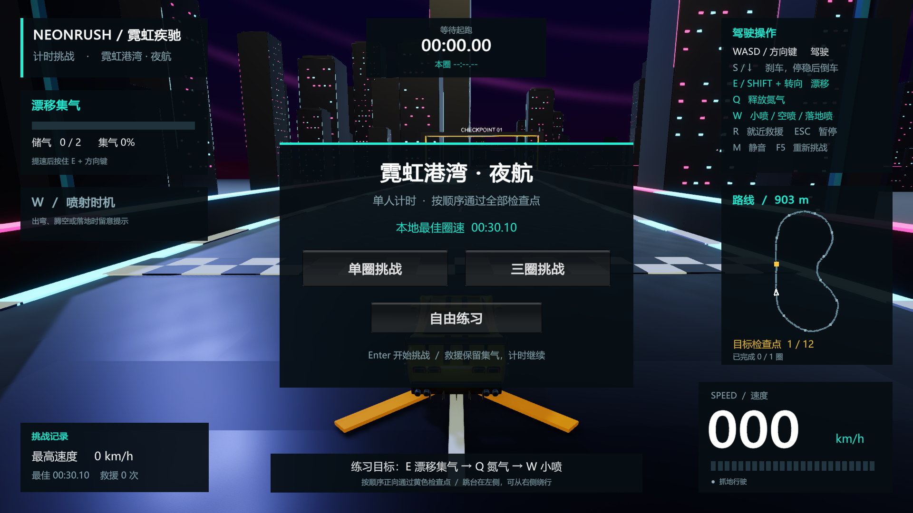

# NeonRush · 霓虹疾驰

Unity 街机竞速原型，包含漂移集气、氮气、小喷、空喷、落地喷，以及单圈/三圈计时挑战。

## 启动

1. 在 Unity Hub 中打开本仓库的 `NeonRush` 文件夹。
2. 使用 Unity **6000.3.26f1**，等待依赖还原和资源导入完成。
3. 在菜单选择 `NeonRush > Open Neon Harbor`。
4. 点击 Play，再点击 Game 窗口，选择挑战或自由练习。

方向键驾驶，E / Shift 漂移，Q 释放氮气，轻点 W 触发小喷/空喷/落地喷，R 救援，Esc 暂停。支持 WASD；推荐方向键驾驶以便左手操作 E/Q/W。

## 内容

- `NeonRush/Assets`：游戏源码、场景、模型、材质、音频与测试。
- `NeonRush/Packages`、`NeonRush/ProjectSettings`：Unity 依赖和项目配置。
- `ArtSource/NeonHarbor`：原创黄色跑车与环境模块的 Blender 源文件和交付说明。
- `Tools/Art`：美术生成脚本。
- `Tools/generate_kart_audio.py`：原创程序合成音频生成脚本。
- `NeonRush/Captures`：阶段截图和验证记录。
- [开发与操作说明](DEVELOPMENT.md)
- [跑车及夜景样板交付说明](ArtSource/NeonHarbor/README.md)

夜景场景保留约 903 米完整比赛路线，重点制作 125–245 米的约 120 米美术样板。原灰盒赛道、训练场与方块车保留，便于回归比较。

## 验证

当前 Play Mode 测试 **31 / 31 通过**，包括完整三圈、跳台喷射、撞墙保留氮气、救援保留集气与库存。

RTX 2070 在 1920×1080 Unity 编辑器 Game View 中，真实单圈采样平均 9.25 ms/帧、P95 11.59 ms。独立 Windows 构建尚未测量。详细结果位于 `NeonRush/Captures/NeonHarbor/`。

Unity MCP 和本地 Blender 桥接工具用于开发，运行游戏本身无需连接 MCP。Unity 缓存、日志、IDE 状态、本地凭据及第三方工具检出目录已通过 `.gitignore` 排除。
